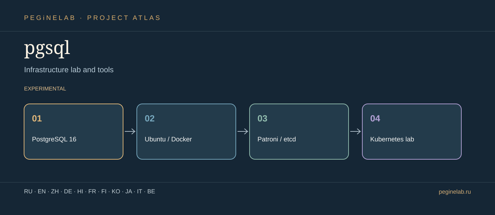

# pgsql · Visual showcase / Презентация

**Инфраструктурные инструменты / Infrastructure lab and tools** · PostgreSQL 16 → Ubuntu / Docker → Patroni / etcd → Kubernetes lab · **experimental**.

**Translation scope:** multilingual project presentation only. This does not imply that the application UI or all technical manuals support these languages.

### Русский · ru
Лаборатория PostgreSQL 16, 1С, Patroni/etcd и Kubernetes. **pgsql**: PostgreSQL 16 → Ubuntu / Docker → Patroni / etcd → Kubernetes lab.

### English · en
PostgreSQL 16 lab for 1C, Patroni/etcd and Kubernetes. **pgsql**: PostgreSQL 16 → Ubuntu / Docker → Patroni / etcd → Kubernetes lab.

### 简体中文 · zh
PostgreSQL 16、1C、Patroni/etcd 与 Kubernetes 实验室。 **pgsql**: PostgreSQL 16 → Ubuntu / Docker → Patroni / etcd → Kubernetes lab.

### Deutsch · de
PostgreSQL-16-Labor für 1C, Patroni/etcd und Kubernetes. **pgsql**: PostgreSQL 16 → Ubuntu / Docker → Patroni / etcd → Kubernetes lab.

### हिन्दी · hi
PostgreSQL 16, 1C, Patroni/etcd और Kubernetes प्रयोगशाला। **pgsql**: PostgreSQL 16 → Ubuntu / Docker → Patroni / etcd → Kubernetes lab.

### Français · fr
Laboratoire PostgreSQL 16, 1C, Patroni/etcd et Kubernetes. **pgsql**: PostgreSQL 16 → Ubuntu / Docker → Patroni / etcd → Kubernetes lab.

### Suomi · fi
PostgreSQL 16 -laboratorio: 1C, Patroni/etcd ja Kubernetes. **pgsql**: PostgreSQL 16 → Ubuntu / Docker → Patroni / etcd → Kubernetes lab.

### 한국어 · ko
PostgreSQL 16, 1C, Patroni/etcd 및 Kubernetes 실험실. **pgsql**: PostgreSQL 16 → Ubuntu / Docker → Patroni / etcd → Kubernetes lab.

### 日本語 · ja
インフラ関連ツール **pgsql**: PostgreSQL 16 → Ubuntu / Docker → Patroni / etcd → Kubernetes lab.

### Italiano · it
Strumenti per infrastrutture **pgsql**: PostgreSQL 16 → Ubuntu / Docker → Patroni / etcd → Kubernetes lab.

### Беларуская · be
Інфраструктурныя інструменты **pgsql**: PostgreSQL 16 → Ubuntu / Docker → Patroni / etcd → Kubernetes lab.

## Public contact details · Контакты

Telegram [@Feudorlab1](https://t.me/Feudorlab1) · Phone [+7 926 041 1145](tel:+79260411145)

[feudor.lab@yandex.ru](mailto:feudor.lab@yandex.ru) · [obzorniky@gmail.com](mailto:obzorniky@gmail.com) · [peginelab.ru](https://peginelab.ru/)

[Source repository](https://github.com/musikfed/pgsql) · Local README remains the technical source of truth.
